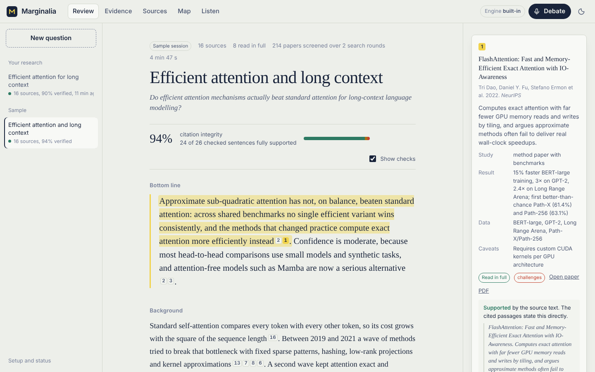
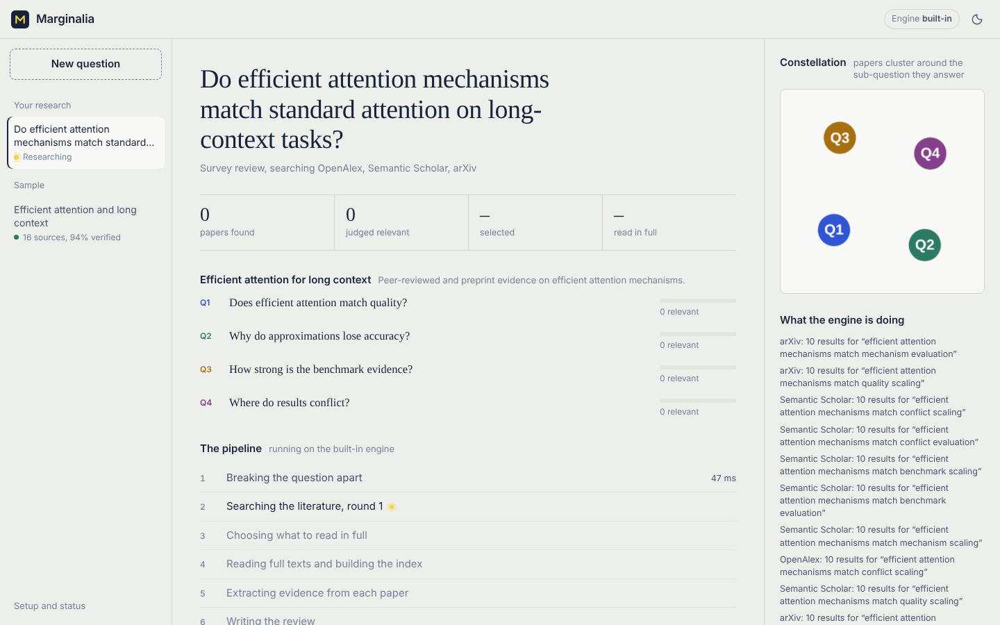
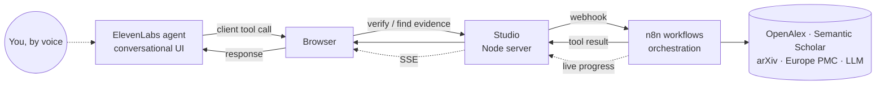

# Marginalia

**Ask the literature a hard question, then argue with the answer.**

Marginalia is a deep research and literature review agent. You type a question; an **n8n** workflow plans a search, queries four scholarly databases, keeps searching in rounds until every part of the question is covered, downloads and reads the open-access PDFs, writes a cited review, and then checks every citation against the source text. When it's done, an **ElevenLabs** voice agent that has read the whole review debates it with you, verifying claims and pulling in new papers mid-conversation, and two ElevenLabs voices perform an audio overview.



## What's in the box

| | |
|---|---|
| **Recursive search** | n8n runs *Search → Screen → Another round?* as a loop. Each round measures coverage per sub-question, writes follow-up queries for the gaps, and snowballs through OpenAlex citations (papers that cite, and are cited by, the strongest hits). |
| **Four sources** | OpenAlex, Semantic Scholar, arXiv, Europe PMC, chosen per field, de-duplicated across DOIs, arXiv IDs and titles. |
| **Full-text RAG** | Open-access PDFs are fetched by n8n's HTTP Request node and parsed by *Extract from File*, then chunked and indexed (BM25, plus dense embeddings when an OpenAI or Gemini key is present). Findings, the review and the audit are all written from retrieved passages. |
| **Citation audit** | A separate pass compares each cited sentence with the cited paper's own text and marks it supported, partly supported or unsupported. Flags show up as underlines in the review and in a "worth a second look" list. |
| **Evidence matrix** | Every claim, every paper, and which way each paper points. Consensus per sub-question. |
| **Citation map** | A force-directed graph of real citation links and topical similarity. |
| **Voice debate** | An ElevenLabs agent in three modes: *Partner*, *Skeptic* (argues against the review), *Examiner* (quizzes you). It drives the UI while it talks: it highlights the sentence it's discussing, opens the source in the margin, verifies claims through n8n, and searches for new evidence live. |
| **Audio overview** | A two-host conversation scripted from the review and performed by ElevenLabs, with the transcript following along. Download as MP3. |
| **Exports** | Markdown (with references), BibTeX, RIS, JSON. |
| **Works without keys** | A sample review ships in the library so you can explore everything before adding keys. |



## Quick start (Docker, recommended)

```bash
cp .env.example .env
# add ONE language model key (Anthropic, OpenAI, Gemini or OpenRouter)
# add ELEVENLABS_API_KEY for voice + audio
docker compose up -d
```

Open **http://localhost:3000**. That's it.

On first start the n8n container imports and publishes both workflows automatically (`n8n/entrypoint.sh`). n8n itself is at http://localhost:5678; create the owner account there once if you want to open the workflows and watch each run's execution. The webhooks work either way.

The first time the studio sees `ELEVENLABS_API_KEY`, it creates its own ElevenLabs agent with the right prompt and client tools, and stores the ID in `data/elevenlabs-agent.json`. If you later change the prompt or tools in `server/elevenlabs.js`, it updates the agent on the next start.

## Deploy it live (Render, free plan)

1. Push this repository to GitHub (public).
2. On [render.com](https://render.com), choose **New → Blueprint**, pick the repository. Render reads `render.yaml`.
3. Fill in the secret values it asks for: one LLM key, `ELEVENLABS_API_KEY`, and a `STUDIO_ACCESS_CODE` of your choice.
4. Deploy. Your app is live at `https://marginalia-xxxx.onrender.com`.

Anyone can open the live app and explore the sample review. Running new research, the voice debate and audio recording ask for the access code once, so visitors can't spend your API credits. The live deployment runs the n8n workflow JSON with the built-in engine (Render's free plan can't run n8n alongside it); `docker compose up` gives you the full n8n stack. The free plan sleeps after 15 idle minutes, so open the link a minute before you demo.

A `Dockerfile` is included for Railway, Fly.io or Cloud Run.

## Without Docker

You need Node 20 or newer. The studio has no npm dependencies.

```bash
cp .env.example .env    # add keys
npm start               # http://localhost:3000
```

If n8n isn't reachable, the studio runs the **same generated workflow JSON** with a small built-in interpreter (`server/engine.js`), so everything works; you lose n8n's execution history and its PDF parser (the built-in one handles simple PDFs and falls back to abstracts). To use your own n8n:

```bash
export N8N_BLOCK_ENV_ACCESS_IN_NODE=false N8N_RUNNERS_TASK_TIMEOUT=900
set -a; source .env; set +a          # the Code nodes read keys from the environment
npx n8n import:workflow --separate --input=n8n/workflows
npx n8n publish:workflow --id=MarginaliaResrch
npx n8n publish:workflow --id=MarginaliaVoiceT
npx n8n start
```

Then set `ENGINE=n8n` (or leave `auto`) and `STUDIO_CALLBACK_URL=http://localhost:3000` in `.env`.

## How it works



The agent's tools are **client tools**: they run in your browser, which relays them through the studio to n8n. That means voice debate works on `localhost` with no public URL or tunnel.

### The research pipeline (n8n)

`Marginalia · Deep research pipeline`, triggered by `POST /webhook/marginalia/research`:

| Node | What it does |
|---|---|
| Research request | Webhook; responds immediately, the run continues in the background |
| Plan the research | Splits the question into sub-questions with academic search queries; picks databases for the field |
| Search the literature | Runs this round's queries across sources, merges and de-duplicates, snowballs citations |
| Screen & find gaps | Keyword pre-filter, then an LLM rates relevance per sub-question; measures coverage and writes follow-up queries |
| Another round? | IF node: loops back to *Search* until coverage or the depth budget is reached |
| Pick papers to read | Ranks by relevance, influence and recency, guarantees breadth per sub-question, queues open-access PDFs |
| Download open-access PDFs | HTTP Request (file), continues on failure |
| Read PDF text | Extract from File (PDF), continues on failure |
| Chunk & index | Chunks full texts (or abstracts), optional embeddings |
| Extract findings | Evidence card per paper; claim-level findings per sub-question from retrieved passages |
| Write the review | Cited Markdown review; strips citations to sources that don't exist |
| Audit every citation | Checks cited sentences against the cited papers' passages |
| Script the audio overview | Two-host script for ElevenLabs |
| Deliver to studio | Builds the citation map and posts the session back |

Every node posts progress to the studio, which streams it to the browser.

`Marginalia · Voice agent tools` exposes `marginalia/verify`, `marginalia/evidence` and `marginalia/health`.

### Depths

| | Sub-questions | Search rounds | Sources in review | Read in full |
|---|---|---|---|---|
| Skim | 3 | 1 | ~10 | up to 4 |
| Survey | 4 | 2 | ~16 | up to 8 |
| Exhaustive | 5 | 3 | ~24 | up to 12 |

## Configuration

All settings live in `.env` (see `.env.example`).

| Variable | Purpose |
|---|---|
| `ANTHROPIC_API_KEY` / `OPENAI_API_KEY` / `GEMINI_API_KEY` / `OPENROUTER_API_KEY` | The language model. The first one found is used. |
| `LLM_PROVIDER`, `LLM_MODEL`, `LLM_FAST_MODEL`, `LLM_BASE_URL`, `LLM_API_KEY` | Override provider, models or point at any OpenAI-compatible endpoint (Ollama, Groq, vLLM…). The writer model drafts the plan, findings, review and podcast; the fast model screens, writes evidence cards, audits and answers live voice tools. |
| `EMBEDDINGS_PROVIDER` | `auto` (use OpenAI/Gemini key if present), `off`, or `custom` |
| `ELEVENLABS_API_KEY` | Voice debate and audio overview |
| `ELEVENLABS_AGENT_ID` | Use your own agent instead of the managed one (configure the client tools listed in `server/elevenlabs.js`) |
| `ELEVENLABS_AGENT_LLM`, `ELEVENLABS_AGENT_VOICE_ID` | Agent model (default `gemini-2.5-flash`) and voice |
| `PODCAST_VOICE_MIRA`, `PODCAST_VOICE_THEO`, `PODCAST_TTS_MODEL` | Audio overview voices and model (falls back to your first two library voices if the defaults aren't available) |
| `OPENALEX_API_KEY` | Recommended. OpenAlex gives a small free daily budget without a key and ten times more with a free key. |
| `SEMANTIC_SCHOLAR_API_KEY` | Optional; avoids rate limiting |
| `CONTACT_EMAIL` | Sent to OpenAlex as a courtesy contact |
| `MARGINALIA_WEBHOOK_TOKEN` | Shared secret so only the studio can trigger the n8n webhooks |
| `ENGINE` | `auto` (default), `n8n`, or `local` |
| `STUDIO_ACCESS_CODE` | On public deployments, required to run research, voice and audio |
| `MAX_CONCURRENT_RUNS` | Research runs allowed at once (default 2) |

## Editing the workflows

The Code-node logic lives in readable files under `n8n/src` (shared helpers in `lib/`, one file per node in `research/` and `tools/`). `npm run build:workflows` assembles them into `n8n/workflows/*.json`, which is what n8n imports and what the built-in engine runs. You can also edit nodes directly in the n8n editor; set `MARGINALIA_AUTO_IMPORT=false` on the n8n service so a restart doesn't overwrite your changes.

## Tests

```bash
npm test     # builds the workflows, then runs them end to end against mock services
npm run check  # structural checks on the workflow JSON
```

The end-to-end test starts mock versions of OpenAlex, arXiv, Semantic Scholar, Europe PMC, a PDF host, an LLM and ElevenLabs (`scripts/mock-services.mjs`), runs Skim and Survey research through the real studio API and the generated workflows, and checks the recursion, de-duplication, PDF reading, citation audit, voice tools, agent provisioning, audio rendering and exports. No keys or network needed.

## Project layout

```
n8n/src/            workflow logic (edit here)
n8n/workflows/      generated n8n workflows (import these)
n8n/entrypoint.sh   imports + publishes on container start
server/             studio: API, SSE, callbacks, ElevenLabs, built-in engine
web/                the interface (no build step)
web/demo/           the sample review
scripts/            tests, mocks, demo builder
```

## Troubleshooting

- **"Research needs a language model key"**: add one key to `.env` and restart (`docker compose restart`).
- **Engine shows "built-in" with Docker running**: open *Setup and status* in the sidebar. If n8n says the workflows aren't published, run `docker compose restart n8n` and check `docker compose logs n8n` for the `[marginalia]` lines.
- **A run stops at "Searching"**: the sources were unreachable or rate limited. Add `OPENALEX_API_KEY`, or try again later.
- **Voice doesn't start**: allow microphone access, and check *Setup and status* for the ElevenLabs agent state.
- **Long runs time out in n8n**: raise `N8N_RUNNERS_TASK_TIMEOUT` (seconds).

## Notes

- Costs: a Survey run makes roughly 25 to 45 LLM calls. The fast model handles most of them.
- The citation audit catches overstatement and drift, but it is a model reading passages, not a peer reviewer. Treat flags as prompts to check the paper.
- The sample review in the library was written by hand about well-known papers to demonstrate the interface; its summaries paraphrase each paper's abstract.
